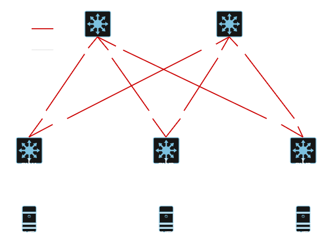

# cisco-nexus-bgp-evpn-vxlan
Multi-Tenant VXLAN fabric -konesaliverkon toteutus Spine-Leaf-arkkitehtuurilla ja Ciscon Nexus 9000v -virtuaalikytkimillä. Toteutettu Kaakkois-Suomen ammattikorkeakoulun VirtualLab-alustalla.

## Verkon topologia

Verkko on rakennettu hyödyntäen Spine Leaf -topologiaa. Leaf-tason Nexus 9000v -kytkimet on yhdistetty Trunk linkeillä Proxmox Virtual Environment -palvelimiin. Linkit Spine-tasolle ovat L3 reititettyjä portteja.

## OSPFv2 Underlay

Fyysinen **Underlay**-verkko on rakennettu hyödyntäen OSPFv2-protokollaa. Prosessi toimii yhdellä **OSPF** alueella (`BACKBONE`) ja sen toimintaa on optimoitu määrittämällä jokaisen siihen liitetyn linkin **OSPF** verkon tyypiksi **point-to-point**. Tällä tavoin **OSPF**:n **Link State Tietokantaan** tallennetaan vain **Router LSA**-tietoja, jolloin tietokannan koko pysyy maltillisena. Jokaisen kytkimen **OSPF Router-Id**ksi on konfiguroitu **loopback 0** -interface. Fyysiset linkit hyödyntävät `ip unnumbered loopback 0` -menetelmää. Lisäksi jokaisen linkin **MTU**-arvo on nostettu 1 550 tavuun, jotta **VXLAN** enkapsulointi ei aiheuta pakettien fragmentointia.
